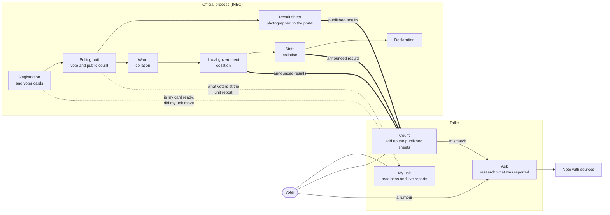
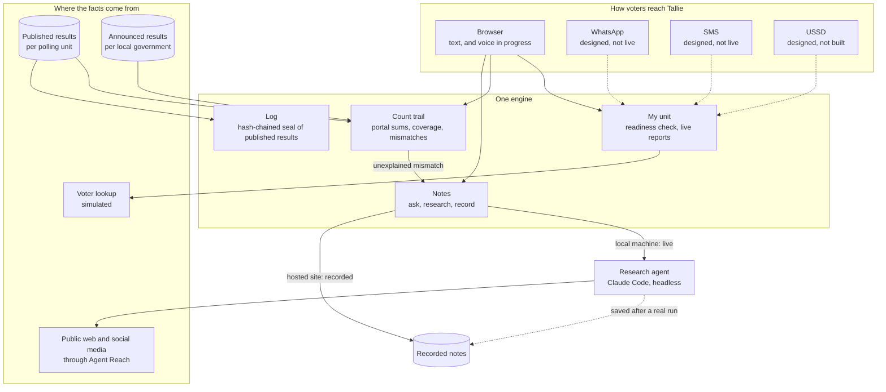
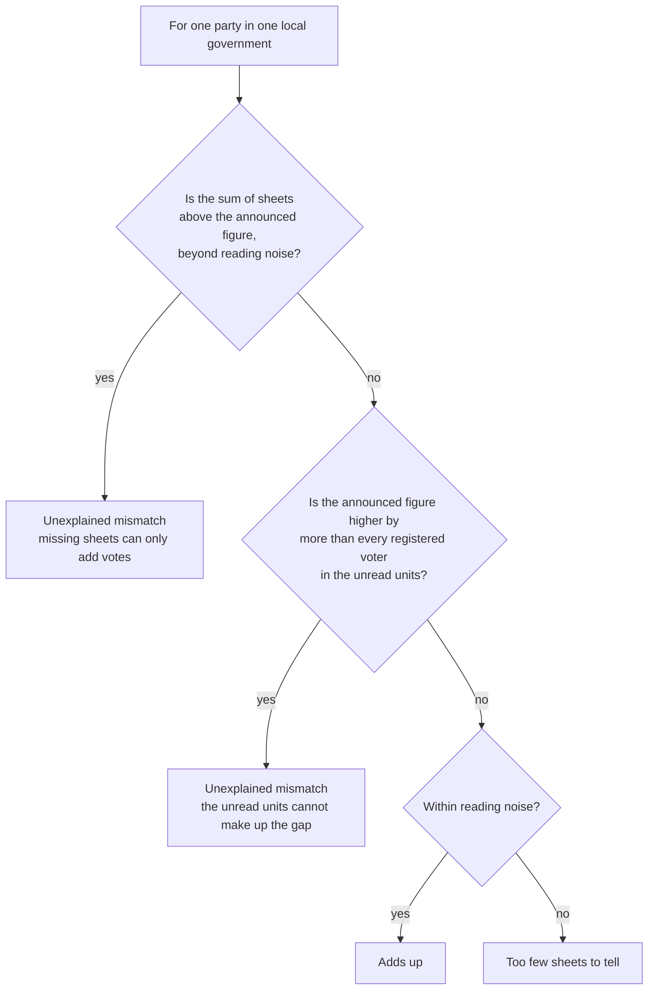

# System sketch

## Where Tallie sits in the election

The top row is the official process. Tallie reads what that process already makes public and never writes back into it.

Ward collation has no arrow into Tallie because ward results are never announced publicly. Tallie shows ward sums as working, and the first real comparison is at local-government level.

## How the parts fit together

## How a mismatch is decided

The code for this is [`lib/count/trail.ts`](../lib/count/trail.ts), about 180 lines with no dependencies, tested on fixtures and on the real Rivers data.

## How it connects to the rest of the system

- **In:** any feed of polling-unit results read from the portal. Today that is one dataset (CCIJ, Rivers 2023). Groups such as the NEDO consortium and Yiaga Africa's ERAD already produce such feeds for 2027; Tallie would consume one, not build another reader.
- **Out:** a per-area mismatch with the two figures, the coverage, the sealed inputs and a sourced note. That is the starting material for a journalist, an observer's statement, or a request to INEC for certified copies.
- **Not replaced:** INEC's collation, observers' parallel vote tabulation, and fact-checkers. Tallie points each of them at where to look.
